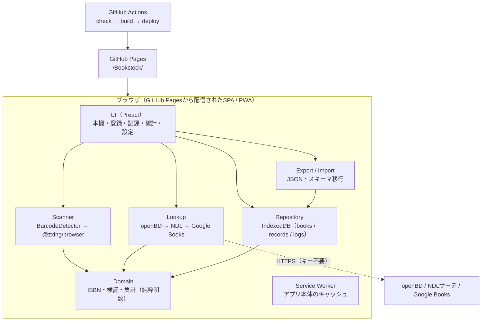
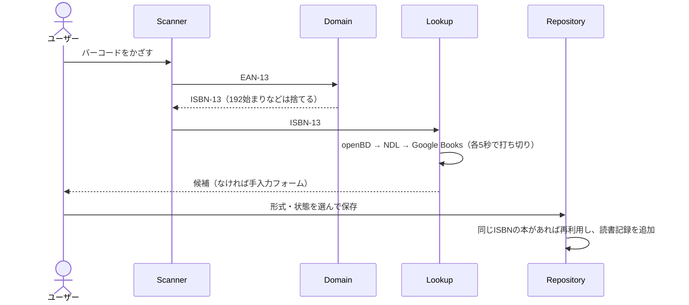

# Bookstock アーキテクチャ

決定の根拠は [CONTEXT.md](../CONTEXT.md) と [docs/adr/](adr/)、実装の順序は [plan.md](plan.md) を参照。

## 全体



## ディレクトリ

| パス           | 役割                                                                       |
| -------------- | -------------------------------------------------------------------------- |
| `src/domain/`  | ISBN、型と検証、統計の集計。DOM・IndexedDBに依存しない（Nodeのテスト対象） |
| `src/lookup/`  | 書誌APIのクライアントと、応答を `Book` へ変換するパーサー                  |
| `src/storage/` | IndexedDBのリポジトリ、エクスポート・インポート、スキーマ移行              |
| `src/scanner/` | カメラとバーコード検出                                                     |
| `src/ui/`      | 画面とSVGグラフ                                                            |
| `tests/`       | Node標準テスト＋tsx。APIは合成fixtureを使う                                |

## 登録の流れ



電子書籍・オーディオブックは、タイトル検索（NDL / Google Books）で候補を出すか、手入力する。

## データモデル（schemaVersion 1）

```ts
type Format = 'paper' | 'ebook' | 'audiobook';
type Status = 'want' | 'stacked' | 'reading' | 'finished' | 'dropped';

interface Book {
  id: string; // crypto.randomUUID()
  isbn13?: string;
  asin?: string;
  title: string;
  authors: string[];
  publisher?: string;
  publishedDate?: string; // YYYY / YYYY-MM / YYYY-MM-DD
  coverUrl?: string;
  pageCount?: number;
  ndc?: string; // 日本十進分類
  source: 'openbd' | 'ndl' | 'google' | 'manual';
}

// コードでは TypeScript の Record 型と区別するため ReadingRecord と呼ぶ。
interface Record {
  id: string;
  bookId: string;
  format: Format;
  platform?: string; // Kindle / Kobo / Audible / audiobook.jp など
  status: Status;
  startedAt?: string; // YYYY-MM-DD
  finishedAt?: string;
  rating?: 1 | 2 | 3 | 4 | 5;
  memo?: string;
  totalMinutes?: number; // オーディオブックの長さ
  tags: string[];
  createdAt: string;
  updatedAt: string;
}

interface ReadingLog {
  id: string;
  recordId: string;
  date: string;
  pages?: number;
  minutes?: number;
}

interface ExportFile {
  schemaVersion: 1;
  exportedAt: string;
  books: Book[];
  records: Record[];
  logs: ReadingLog[];
}
```

- IndexedDBのstore: `books`（index: `isbn13`）、`records`（index: `bookId`、`status`、`finishedAt`）、`logs`（index: `recordId`、`date`）。
- インポートは検証してから、1つのトランザクションで置換、またはIDで統合する。統合の結果も参照の整合性を検証する。不正なファイルでは何も書き込まない。
- IndexedDBから読み出した値も同じ検証にかける。壊れていたら画面に流さずにエラーを表示する。
- 本と記録の追加は1つのトランザクションで行う。同じISBNの本は再利用する（ISBNのない本は毎回新しい本になる）。記録を消すと、その進捗ログと、どの記録からも参照されなくなった本も消す。
- 検証は `src/domain/validate.ts`、IndexedDBは `src/storage/db.ts`、ファイルの読み込みは `src/storage/export-file.ts`。

## 画面

| 画面 | ハッシュ        | 内容                                           |
| ---- | --------------- | ---------------------------------------------- |
| 本棚 | `#/`            | 書影のグリッド。形式・状態・タグで絞り込む     |
| 登録 | `#/add`         | スキャン / ISBN入力 / タイトル検索 / 手入力    |
| 記録 | `#/records/:id` | 状態・期間・評価・メモ・進捗ログの編集         |
| 統計 | `#/stats`       | 下記のグラフ（M5で追加）                       |
| 設定 | `#/settings`    | エクスポート・インポート、永続ストレージの状態 |

- 上部のナビ（本棚 / 登録 / 設定）で切り替える。ハッシュの解釈は `src/ui/route.ts`。知らないハッシュは本棚にする。
- 登録すると、その記録の画面へ移る。記録の画面では、状態・日付・評価・メモ・タグ・進捗ログの編集と、本の情報の編集、同じ本の別形式の記録の追加、記録の削除ができる。
- 本棚の「選択」で複数の記録を選び、形式をまとめて変えられる（`changeFormat`、`Repository.changeFormat`。1つのトランザクションで書き、1件でも不正なら何も書かない）。
- 本棚の絞り込み（形式・状態・タグ・キーワード）は `src/domain/shelf.ts`。キーワードはNFKCでそろえて、タイトルと著者に部分一致させる。

## 統計

集計は `src/domain/stats.ts` の純粋関数で行い、`src/ui/stats.tsx`（`#/stats`）がSVGで描く。

- 期間は年（今年・去年・ほかの年）か全期間。全期間で24か月を超えたら年ごとに数える。
- 読了は読了日（`finishedAt`）で数える。登録日では代用しない（過去分をまとめて登録したときに、登録した月へ偏らないようにするため）。読了日のない読了記録は集計から除き、件数を注記する。
- サマリーは、読了（記録数と本の数）、ページ（紙・電子の読了の `pageCount` の合計と1日あたり）、聴いた時間（オーディオの `totalMinutes`。なければその記録の進捗ログの分の合計。どちらもない記録は一覧に出し、記録の画面へ直しに行ける）、月平均と最多の月。今年は今日までの日数・月数で割る。ページ数・長さのない記録は0として数え、件数を注記する。
- 月別の積み上げ棒（形式別、指標は冊・ページ・時間を切り替え、軸は1本）。棒をタップすると内訳を表示し、表でも見られる。
- 読書カレンダーは、進捗ログのページ＋分と、読了日を日ごとに数えたヒートマップ（単色の濃淡）。
- 状態の内訳（現在）、評価の分布、NDC大分類の内訳は横棒。
- 形式の3色はdatavizの検証をライト（面 #ffffff）とダーク（面 #1c1c1e）で通した値。ライトの水色はコントラストが3:1未満なので、凡例・内訳の文字・表を必ず付ける。
